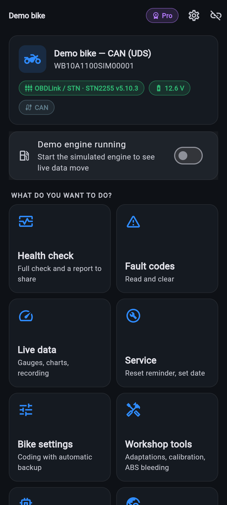
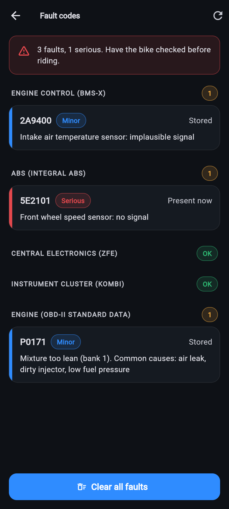
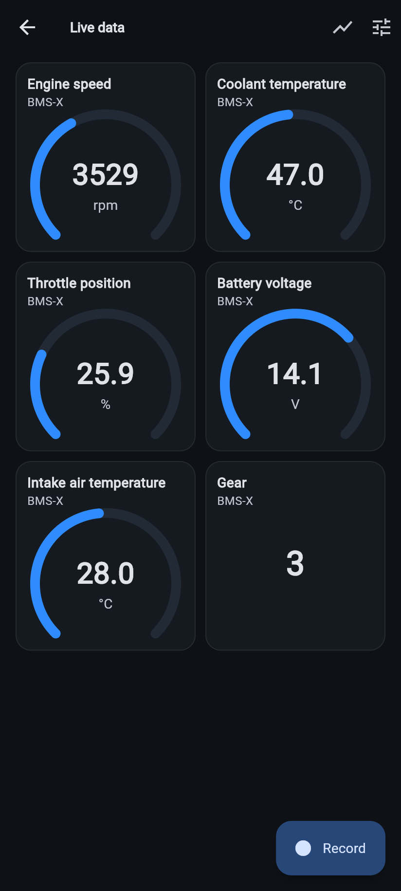
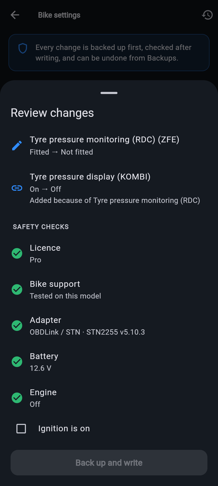

# RideScope

Diagnostics for BMW motorcycles: fault codes, live data, service reset,
coding, adaptations, ABS bleeding. Built from scratch in Flutter as a
cleaner, cross-platform alternative to MotoScan, with three licence tiers.

See [docs/ANALYSIS.md](docs/ANALYSIS.md) for the MotoScan feature analysis,
why this is a clean-room build rather than a decompiled APK, the
architecture and the protocol notes.

| | | | |
|---|---|---|---|
|  |  |  |  |

## What's here

```
lib/
  core/transport/   Bluetooth Classic SPP (Android), BLE (Android/iOS), Wi-Fi, simulator
  core/adapter/     ELM327 / STN / UniCarScan driver, adapter detection, ISO-TP
  core/protocol/    KWP2000 (K-line), UDS (CAN, BMW extended addressing), OBD-II
  core/ecu/         Data-driven ECU profiles, scaling, data templates, fault texts
  core/services/    Faults, live data, procedures, coding (backup/verify/restore),
                    safety preflight, discovery, health report
  core/sim/         Virtual bike: ELM327 emulator + KWP/UDS/OBD ECUs
  licensing/        Free / Plus / Pro, Ed25519 licence keys, store purchases
  ui/               Screens
assets/profiles/    Bike profiles (JSON), generated by tool/gen_profiles.py
android/.../SppPlugin.kt   Native RFCOMM link for Bluetooth Classic adapters
tool/license_tool.dart     Create signing keys and licence keys
```

## Installing on an Android phone

See [docs/BUILD_ANDROID.md](docs/BUILD_ANDROID.md): download the APK that
GitHub Actions builds on every push, or build it on your own computer.

## Running it

```sh
flutter pub get
flutter test                      # 50 tests: protocols, services, licensing, UI
flutter run                       # phone attached; "Try the demo bike" needs no hardware
flutter run -d chrome             # web build runs the demo bike only
```

Debug builds have a **Developer** section on the Licence screen to unlock Plus
or Pro, so you can test paid features on your own bike without a store
purchase. It isn't in release builds.

## Testing on your bike

The demo profiles are complete and verified against the simulator. The real
BMW profiles (`bmw_can.json`, `bmw_kline.json`) ship with standard
identification and OBD-II data only. Their BMW-specific addresses are
unverified, so **every write function is locked on a real bike** until
the profile is confirmed. Recommended order:

1. Use an OBDLink LX / MX+ / CX (or UniCarScan) adapter. A cheap ELM327
   works for reading only.
2. Connect with "Detect automatically". The app picks CAN or K-line.
3. Read faults, live data (OBD-II values work on Euro 4+ bikes), and
   *Control units*.
4. *Discovery › Find units* (Pro). Lists every ECU address that answers.
5. *Discovery › Find values*. Read-only scan of identifiers. Tap one to watch it
   live while you twist the throttle or switch the lights. Share the raw log
   (top-right) so the profile can be filled in and marked verified.
6. Only then enable service reset / coding for that model, one low-risk item
   at a time, using the automatic backup.

## Licensing

| | Free | Plus | Pro |
|---|---|---|---|
| Identify, read faults, basic live data | ✓ | ✓ | ✓ |
| Clear faults, all live data + recording, freeze frames, report | | ✓ | ✓ |
| Service reset, cluster date | | ✓ | ✓ |
| Coding, adaptations, actuator tests, ABS bleeding, discovery, expert mode | | | ✓ |
| Bikes | 1 | 2 | unlimited |

Tiers are enforced in the service layer (`DiagnosticSession.require`), not just
the UI.

**Before release:**

1. `dart run tool/license_tool.dart keygen`: keep the private seed out of git
   and paste the public key into `lib/licensing/license_keys.dart`. The
   committed key is a placeholder whose private half was discarded.
2. Create non-consumable products `ridescope_plus`, `ridescope_pro` and
   `ridescope_plus_to_pro` in Play Console / App Store Connect.
3. Add server-side receipt validation before calling
   `LicenseService.setStoreTier` (see `purchase_service.dart`).
4. Issue workshop keys with
   `dart run tool/license_tool.dart sign --seed <seed> --tier pro --holder "Name" [--vin VIN] [--days 365]`.

BLE uses `flutter_reactive_ble` (BSD). `flutter_blue_plus` was avoided on
purpose: it now needs a paid licence for commercial apps.

## Deliberately not supported

Odometer changes, immobiliser/key programming, security-access bypass,
emissions-related deletes and ECU flashing.

RideScope is independent and not affiliated with BMW AG. BMW and BMW Motorrad
are trademarks of BMW AG.
